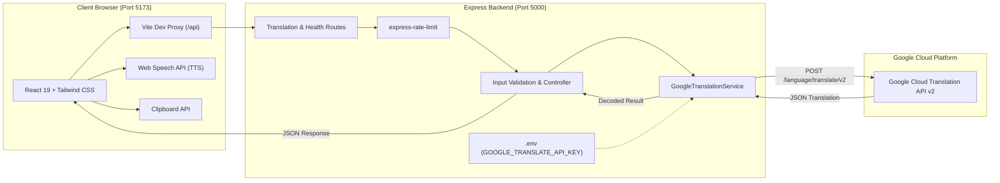

# LinguaFlow — Language Translation Tool

> **"Break Language Barriers. Connect the World."**  
> A full-stack, responsive web application for real-time multilingual text translation powered by the official Google Cloud Translation API, featuring automatic language detection, text-to-speech audio playback, and instant clipboard utilities.

---

## Table of Contents
1. [Project Overview](#project-overview)
2. [Problem Statement](#problem-statement)
3. [Project Objectives](#project-objectives)
4. [Key Features](#key-features)
5. [Technology Stack](#technology-stack)
6. [System Architecture](#system-architecture)
7. [Project Folder Structure](#project-folder-structure)
8. [Application Workflow](#application-workflow)
9. [Prerequisites](#prerequisites)
10. [Installation & Setup](#installation--setup)
11. [Google Cloud Translation API Setup Guide](#google-cloud-translation-api-setup-guide)
12. [Environment Variable Configuration](#environment-variable-configuration)
13. [Running the Application](#running-the-application)
14. [Testing the Application](#testing-the-application)
15. [API Endpoint Documentation](#api-endpoint-documentation)
16. [Security Considerations](#security-considerations)
17. [Troubleshooting & Common Errors](#troubleshooting--common-errors)
18. [Current Limitations & Future Enhancements](#current-limitations--future-enhancements)

---

## Project Overview

**LinguaFlow** is an end-to-end full-stack web application designed for accurate, intuitive language translation. Built to fulfill college project requirements and professional software standards, it combines a modern React + TypeScript frontend with a secure Node.js + Express backend that securely manages communication with the Google Cloud Translation API v2.

---

## Problem Statement

In an increasingly globalized world, language barriers prevent effective cross-cultural communication, hinder academic research, and complicate business exchanges. Many existing free tools are either cluttered with intrusive advertisements, lack speech synthesis, or expose sensitive API credentials on the client side. LinguaFlow provides a clean, responsive, and privacy-focused solution that pairs reliable machine translation with voice accessibility tools and a secure backend proxy.

---

## Project Objectives

- **Direct Multilingual Translation**: Translate between over 30 global and Indian regional languages (English, Telugu, Hindi, Tamil, Kannada, Malayalam, Bengali, Spanish, French, German, Japanese, and more).
- **Zero Frontend Credential Exposure**: Securely insulate third-party cloud API keys behind an Express.js server.
- **Accessible Voice Output**: Provide browser-native text-to-speech (TTS) via the Web Speech API without requiring additional paid services.
- **Adaptive UX**: Deliver an intuitive interface across smartphones, tablets, laptops, and large desktop screens.
- **Robust Error Handling**: Provide clear, actionable feedback when network interruptions occur or when Cloud credentials need configuration.

---

## Key Features

- **Dual-Panel Translation Workspace**: Side-by-side editing on desktop, vertically stacked on mobile screens.
- **Automatic Language Detection**: Detect source text language automatically via Google's neural language detection model.
- **Bidirectional Language Swapping**: Instantly invert source and target languages and transfer translated text.
- **One-Click Clipboard Copying**: Copies translations to the system clipboard with visual confirmation badges.
- **Web Speech Text-to-Speech**: Listen to native-language pronunciation for both source input and translated results.
- **Character Counter & Input Validation**: Real-time counter up to 5,000 characters with auto-validation.
- **Keyboard Shortcut**: Press `Ctrl + Enter` (or `Cmd + Enter` on macOS) to instantly translate.
- **Live Backend Health Badge**: Real-time health indicator in the header reflecting server and API key status.

---

## Technology Stack

### Frontend
- **Framework**: React 19 + TypeScript
- **Build Tool**: Vite 6
- **Styling**: Tailwind CSS
- **Iconography**: Lucide React
- **Web APIs**: Browser Clipboard API, Web Speech API (`SpeechSynthesis`)
- **Testing**: Vitest, React Testing Library, JSDOM

### Backend
- **Runtime**: Node.js (v18+)
- **Framework**: Express.js with TypeScript
- **HTTP Client**: Axios
- **Security & Utilities**: CORS, dotenv, express-rate-limit
- **Testing**: Vitest, Supertest

---

## System Architecture



---

## Project Folder Structure

```
LANGUAGE TRANSACTION TOOL/
│
├── client/                               # Frontend React + TypeScript application
│   ├── public/                           # Static assets
│   ├── src/
│   │   ├── __tests__/                    # Vitest UI test suite
│   │   │   └── App.test.tsx
│   │   ├── components/                   # Reusable UI components
│   │   │   ├── FeatureCard.tsx           # Capability cards
│   │   │   ├── Footer.tsx                # Application footer
│   │   │   ├── Header.tsx                # Sticky navbar & health badge
│   │   │   ├── LanguageSelector.tsx      # Accessible searchable dropdown
│   │   │   └── TranslationWorkspace.tsx  # Dual translation panels & actions
│   │   ├── data/
│   │   │   └── languages.ts              # Supported language definitions & locales
│   │   ├── hooks/
│   │   │   └── useSpeech.ts              # Custom Web Speech API hook
│   │   ├── services/
│   │   │   └── translationService.ts     # Frontend HTTP client
│   │   ├── test/
│   │   │   └── setup.ts                  # Test environment mocks
│   │   ├── types/
│   │   │   └── translation.ts            # TypeScript interfaces
│   │   ├── App.tsx                       # Main application view
│   │   ├── index.css                     # Tailwind styles & animations
│   │   ├── main.tsx                      # DOM entrypoint
│   │   └── vite-env.d.ts                 # Vite environment definitions
│   ├── index.html                        # HTML template with Google Fonts
│   ├── package.json                      # Frontend dependencies & scripts
│   ├── postcss.config.js                 # PostCSS setup
│   ├── tailwind.config.js                # Tailwind CSS configuration
│   ├── tsconfig.json                     # TypeScript client configuration
│   └── vite.config.ts                    # Vite dev proxy & Vitest config
│
├── server/                               # Backend Node.js + Express application
│   ├── src/
│   │   ├── __tests__/                    # Vitest server test suite
│   │   │   └── translation.test.ts
│   │   ├── constants/
│   │   │   └── languages.ts              # Server supported language codes
│   │   ├── controllers/
│   │   │   └── translationController.ts  # Route handlers & validation
│   │   ├── middleware/
│   │   │   └── errorHandler.ts           # Central error response handler
│   │   ├── routes/
│   │   │   └── translationRoutes.ts      # Rate-limited Express router
│   │   ├── services/
│   │   │   └── googleTranslationService.ts # Google Cloud Translation API client
│   │   ├── app.ts                        # Express application factory
│   │   └── server.ts                     # HTTP listener entrypoint
│   ├── .env.example                      # Template for backend secrets
│   ├── package.json                      # Backend dependencies & scripts
│   └── tsconfig.json                     # TypeScript server configuration
│
├── .gitignore                            # Git exclusion rules
├── package.json                          # Root orchestration scripts
└── README.md                             # Documentation
```

---

## Application Workflow

1. **User Input**: The user types text in the left panel (up to 5,000 characters).
2. **Language Configuration**: The user selects or searches for source and target languages (e.g. English $\rightarrow$ Telugu). "Auto Detect" can be chosen for source text.
3. **Dispatch**: The user clicks **Translate Text** or presses `Ctrl + Enter`.
4. **Backend Validation**: The request is posted to `/api/translate`. Express validates the text type, length, and language codes.
5. **Google Cloud Call**: The backend securely calls Google Cloud Translation API v2 with the server's private API key.
6. **Response Rendering**: The translated text is returned, HTML entities (if any) are sanitized, and the result is displayed in the right panel.
7. **Post-Translation Actions**: The user can copy the translation or listen to pronunciation via text-to-speech.

---

## Prerequisites

- **Node.js**: Version 18.x or later installed (`node -v`)
- **npm**: Version 9.x or later installed (`npm -v` or `npm.cmd -v` on Windows)
- **Google Cloud Account**: Required to obtain a Google Cloud Translation API key for live translations.

---

## Installation & Setup

Clone or open the repository folder:

```bash
# Install all dependencies across root, server, and client:
npm run install:all
```

Alternatively, install each subproject manually:
```bash
# Root dependencies
npm install

# Backend dependencies
cd server
npm install
cd ..

# Frontend dependencies
cd client
npm install
cd ..
```

---

## Google Cloud Translation API Setup Guide

To execute **real, live translations**, an official Google Cloud Translation API credential is required:

1. **Visit Google Cloud Console**:  
   Navigate to [https://console.cloud.google.com/](https://console.cloud.google.com/).
2. **Create / Select a Project**:  
   Click the project dropdown at the top and select or create a project.
3. **Enable Cloud Translation API**:  
   In the navigation menu, go to **APIs & Services > Library**, search for **Cloud Translation API**, and click **Enable**.
4. **Create API Key**:  
   Go to **APIs & Services > Credentials**, click **Create Credentials**, and choose **API Key**.
5. **Restrict API Key (Recommended)**:  
   Click **Edit API Key**. Under *API restrictions*, choose *Restrict key* and select only **Cloud Translation API**. Save changes.
6. **Configure the Key Locally**:  
   Create a `.env` file in the `server/` directory and paste your key:
   ```bash
   cp server/.env.example server/.env
   ```
   Edit `server/.env`:
   ```env
   PORT=5000
   CLIENT_ORIGIN=http://localhost:5173
   GOOGLE_TRANSLATE_API_KEY=AIzaSyYourActualKeyHere
   ```
7. **Restart the Backend**: Restart the server process to load the new environment variable.

> **Note on Free Tier**: Google Cloud provides a free tier with 500,000 characters translated per month at zero cost.

---

## Running the Application

### Option A: Run Both Simultaneously (Recommended)
From the root directory:
```bash
npm run dev
```
This runs the Express backend on `http://localhost:5000` and the Vite dev server on `http://localhost:5173` concurrently.

### Option B: Run Individually in Separate Terminals

**Terminal 1 — Backend:**
```bash
cd server
npm run dev
```

**Terminal 2 — Frontend:**
```bash
cd client
npm run dev
```

Open your browser and navigate to:
```
http://localhost:5173
```

---

## Testing the Application

Both backend and frontend contain dedicated automated test suites.

### Run All Tests
```bash
npm run test
```

### Run Backend Tests Only
```bash
npm run test:server
```
*Tests input validation, language whitelist checks, character limits, health endpoint, HTML entity decoding, and mocked Google API communication.*

### Run Frontend Tests Only
```bash
npm run test:client
```
*Tests UI mounting, default language selection, translate button activation, loading states, error display, language swapping, clearing, and clipboard copy.*

---

## Production Build

To verify that TypeScript compiles with zero errors and assets bundle successfully:

```bash
# Build both subprojects
npm run build
```

Or individually:
```bash
npm run build:server   # Compiles backend TypeScript to server/dist
npm run build:client   # Compiles client TypeScript & bundles with Vite
```

---

## API Endpoint Documentation

### 1. Health Check
- **Endpoint**: `GET /api/health`
- **Description**: Returns server status and verifies whether the Google API key is configured.
- **Example Response**:
```json
{
  "status": "healthy",
  "service": "LinguaFlow Translation Backend",
  "uptimeSeconds": 142,
  "timestamp": "2026-10-09T05:30:00.000Z",
  "googleTranslateApiKeyConfigured": true,
  "setupNote": "Google Cloud Translation API credential detected."
}
```

---

### 2. Translate Text
- **Endpoint**: `POST /api/translate`
- **Rate Limit**: 60 requests per minute per IP.
- **Headers**: `Content-Type: application/json`

#### Request Body
```json
{
  "text": "Hello, how are you?",
  "sourceLanguage": "en",
  "targetLanguage": "te"
}
```
*Note: For automatic source language detection, set `sourceLanguage: "auto"` or omit the field.*

#### Success Response (`200 OK`)
```json
{
  "success": true,
  "data": {
    "translatedText": "నమస్కారం, మీరు ఎలా ఉన్నారు?",
    "detectedSourceLanguage": "en"
  }
}
```

#### Error Response Examples

- **400 Bad Request** (Empty or whitespace input):
```json
{
  "success": false,
  "error": "Invalid input: \"text\" cannot be empty or contain only whitespace.",
  "code": "EMPTY_TEXT"
}
```

- **503 Service Unavailable** (Missing API Key):
```json
{
  "success": false,
  "error": "Google Cloud Translation API key is not configured on the backend. Please add GOOGLE_TRANSLATE_API_KEY to server/.env.",
  "code": "API_KEY_NOT_CONFIGURED"
}
```

---

## Security Considerations

1. **Credential Isolation**: The Google Cloud API key is solely accessed in `server/src/services/googleTranslationService.ts` via `process.env.GOOGLE_TRANSLATE_API_KEY`. It is never returned in HTTP responses or bundled into client code.
2. **CORS Restrictions**: Express restricts origin access to `http://localhost:5173` (configurable via `CLIENT_ORIGIN`), disallowing unauthorized origins.
3. **Rate Limiting**: Integrated `express-rate-limit` prevents Denial of Service (DoS) and quota exhaustion.
4. **Input Sanitization**: Length is capped at 5,000 characters, payload JSON bodies are capped at 100kb, and HTML entity decoding protects against injection artifacts.

---

## Troubleshooting & Common Errors

| Issue | Cause | Resolution |
| :--- | :--- | :--- |
| **"API Key Needed" / 503 error** | `GOOGLE_TRANSLATE_API_KEY` is not defined in `server/.env` | Create `server/.env` with your real key following the setup guide. |
| **"API_AUTH_FAILED" / 403 error** | Invalid key or Cloud Translation API not enabled in Google Cloud Console | Ensure Cloud Translation API is enabled on your Google Cloud project and the API key has not expired. |
| **"Backend Offline" badge** | Express server is not running on port 5000 | Run `npm run dev:server` in another terminal or check for port conflicts. |
| **No audio output** | Browser lacks installed speech voice for selected language | Web Speech API relies on operating system voices. Common languages (English, Spanish, Hindi) are preinstalled; check OS language packs for additional voice models. |
| **EADDRINUSE (Port 5000 in use)** | Another process is already running on port 5000 | Terminate the process using port 5000, or modify `PORT` in `server/.env`. |

---

## Current Limitations & Future Enhancements

- **Voice Availability**: The Web Speech API depends on native operating system voices; in future releases, an optional server-side Cloud Text-to-Speech integration could provide consistent voices across all platforms.
- **Document Translation**: Future versions can add `.docx` and `.pdf` file upload translation.
- **Translation History**: An optional local storage session history feature could allow users to review recent translations.

---

## License & Attribution

Developed for college academic project submission and demonstration. All translations are performed via Google Cloud Translation API.
